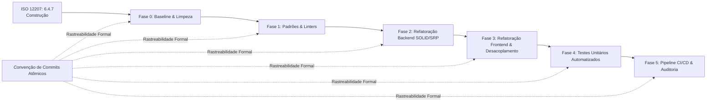

# Plano de Adequação à Norma ISO/IEC/IEEE 12207:2017
## Processo 6.4.7: Construção de Software (*Software Construction Process*)

> **Projeto**: Receitas (Plataforma de Gestão e Reprodução de Cursos Locais)  
> **Referência Normativa**: ISO/IEC/IEEE 12207:2017 (Processos de Ciclo de Vida de Software)  
> **Objetivo**: Transicionar a base de código de um protótipo funcional/MVP para um produto aderente aos padrões formais de Engenharia de Software, com foco em padrões de codificação, princípios Clean Code/SOLID, verificação contínua e rastreabilidade total por meio de commits atômicos.

---

## 1. Visão Geral e Alinhamento Normativo

O processo **6.4.7 (Construção de Software)** da ISO 12207 tem como propósito *produzir unidades de software executáveis que reflitam o projeto de software*. Seus resultados mandatórios (*outcomes*) são:

1. **Critérios de construção definidos (6.4.7.2.a)**: Estabelecimento de regras de estilo, padrões de codificação, segurança e convenções de nomenclatura.
2. **Unidades de software construídas (6.4.7.2.b)**: Implementação modularizada, desacoplada e coesa respeitando princípios de Clean Code e SOLID.
3. **Unidades de software verificadas (6.4.7.2.c)**: Testes unitários automatizados, análise estática de código e revisões formais.
4. **Rastreabilidade estabelecida (6.4.7.2.d)**: Rastreabilidade bidirecional entre design/requisitos, unidades de software e itens de configuração.

Para garantir a rastreabilidade exigida pela norma, este plano utiliza como espinha dorsal a **Gerência de Configuração (ISO 12207, Processo 6.3.5)** por meio de **commits atômicos padronizados**.



---

## 2. Padrão de Commits Atômicos e Rastreabilidade

### 2.1. O que é um Commit Atômico neste Plano?
Cada commit deve satisfazer três propriedades fundamentais:
1. **Unicidade de Propósito**: Resolve uma única preocupação lógica (não misturar refatoração com correção de bug ou formatação).
2. **Compilabilidade e Integridade**: A aplicação deve compilar e os testes existentes devem passar em cada commit individual. Não é permitido criar commits intermediários quebrados.
3. **Rastreabilidade Explicita**: A mensagem do commit referencia diretamente o identificador do processo ou da tarefa de adequação.

### 2.2. Sintaxe Padronizada de Mensagem
A mensagem adota a especificação **Conventional Commits 1.0.0** estendida com identificador de requisito/processo:

```text
<tipo>(<escopo>): [ISO-<processo>-<id>] <descrição imperativa no presente>

[corpo opcional explicando o 'porquê' e as decisões de design]

[rodapé opcional com referências a issues ou breaking changes]
```

#### Tipos Permitidos:
* `build`: Alterações no sistema de build, dependências ou contêineres.
* `ci`: Configuração de pipelines de integração contínua (GitHub Actions).
* `style`: Formatação, linters, remoção de espaços em branco (sem impacto em lógica).
* `refactor`: Alteração de código que não corrige bug nem adiciona funcionalidade (SOLID, SRP, Clean Code).
* `test`: Adição ou correção de testes unitários ou de integração.
* `docs`: Alteração exclusiva de documentação ou comentários.
* `feat`: Implementação de nova funcionalidade ou capacidade de engenharia.
* `fix`: Correção de defeito/bug.

#### Exemplos de Mensagens Válidas:
* `style(backend): [ISO-6.4.7-CRIT01] enforce ruff and black formatting rules`
* `refactor(backend/courses): [ISO-6.4.7-SRP02] extract course business logic to course_service`
* `test(backend/utils): [ISO-6.4.7-VERIF01] add unit tests for natural_sort_key and file filters`
* `refactor(frontend/player): [ISO-6.4.7-SRP05] isolate screenshot export logic into custom hook`

---

## 3. Matriz de Rastreabilidade (ISO 12207 ↔ Atividades ↔ Commits)

| ID do Item | Requisito da ISO 12207 | Problema no Projeto Atual | Ação Corretiva | Tipo de Commit |
| :--- | :--- | :--- | :--- | :--- |
| **ISO-6.3.5-CM01** | Integridade da Linha de Base (Baseline) | Pasta `backend/src` contém cópia do frontend misturada com Python. | Eliminar código morto e arquivos duplicados em `backend/src`. | `build(config)` |
| **ISO-6.4.7-CRIT01** | Critérios e Guias de Estilo (Python) | Falta de linter, PEP 8 violada, nomes mistos em modelos (`isCoverUrl` vs `course_id`). | Configurar Ruff/Black e padronizar convenção `snake_case` no backend. | `style(backend)` |
| **ISO-6.4.7-CRIT02** | Critérios e Guias de Estilo (TypeScript) | ESLint configurado no `package.json`, mas sem arquivo `.eslintrc.*` (falha na execução). | Configurar ESLint (`.eslintrc.cjs`) e Prettier com checagens estritas. | `style(frontend)` |
| **ISO-6.4.7-SRP01** | Construção Modular (SOLID - SRP) | `app.py` executa DDL cru com `ALTER TABLE` e `DELETE` no boot. | Adicionar Flask-Migrate / Alembic para controle formal de migrações. | `refactor(backend/db)` |
| **ISO-6.4.7-SRP02** | Construção Modular (SOLID - SRP) | `routes.py` acumula HTTP, Queries SQL, I/O em disco e cálculo de progresso. | Extrair camadas: Routers $\to$ Services $\to$ Repositories / DTOs. | `refactor(backend)` |
| **ISO-6.4.7-SRP03** | Construção Modular (Clean Code) | `print()` e `console.log` dispersos para depuração em produção. | Implementar módulo de logging unificado e estruturado. | `refactor(common)` |
| **ISO-6.4.7-SRP04** | Construção Modular (SOLID - Abstração) | Modelos TypeScript tipam flags booleanas como `number` (0 ou 1) por vazamento do SQLite. | Criar DTOs de resposta que convertem tipos para booleanos nativos. | `refactor(models)` |
| **ISO-6.4.7-SRP05** | Construção Modular (SOLID - SRP) | `player.tsx` com ~380 linhas, eventos globais em `window` e múltiplos papéis. | Separar Player UI, lógica de progresso (Zustand) e captura de tela (hooks). | `refactor(frontend)` |
| **ISO-6.4.7-VERIF01** | Verificação de Unidades | Zero testes unitários no backend (apenas script manual `test_upload.py`). | Implementar suíte de testes unitários com `pytest` e cobertura de rotas/serviços. | `test(backend)` |
| **ISO-6.4.7-VERIF02** | Verificação de Unidades | Zero testes unitários ou de componentes no frontend. | Configurar `vitest` e `@testing-library/react` com testes de renderização. | `test(frontend)` |
| **ISO-6.4.7-CI01** | Rastreabilidade e Validação Contínua | Inexistência de pipeline de CI/CD. | Criar GitHub Actions para lint, verificação de tipos e execução de testes. | `ci(github)` |

---

## 4. Cronograma Evolutivo de Adequação (Roadmap em Fases)

### Fase 0: Linha de Base e Higienização de Configuração (Semana 1)
> **Foco**: ISO 12207 - Processo 6.3.5 (Gerência de Configuração). Eliminar ruído e estabilizar o repositório.

1. **Remoção de Código Morto e Duplicado**:
   * Excluir da pasta `backend/` os arquivos residuais do frontend (`backend/src/components`, `backend/src/pages`, `backend/src/hooks`, `backend/src/main.tsx`, `backend/package.json`, etc.).
   * Garantir que `backend/` contenha unicamente arquivos pertinentes ao serviço Python.
2. **Padronização de Ambiente de Desenvolvimento**:
   * Criar arquivo `.editorconfig` na raiz do repositório definindo encoding UTF-8, fim de linha LF, indentação e corte de espaços finais.
   * Ajustar `.gitignore` para cobrir artefatos Python (`__pycache__`, `.pytest_cache`, `.venv`) e Node (`node_modules`, `dist`).

#### Commits Atômicos da Fase 0:
```bash
git commit -m "build(config): [ISO-6.3.5-CM01] clean up duplicated frontend assets from backend directory"
git commit -m "build(config): [ISO-6.3.5-CM02] add root .editorconfig and update .gitignore for both stacks"
```

---

### Fase 1: Imposição de Padrões de Codificação e Análise Estática (Semana 2)
> **Foco**: ISO 12207 - 6.4.7.2.a (Critérios de Construção). Nenhuma linha de código novo deve ser escrita sem linters ativos.

1. **Backend (Python)**:
   * Adicionar `ruff` e `black` ao ambiente de desenvolvimento do backend.
   * Criar `backend/pyproject.toml` configurando tamanho máximo de linha (88 colunas), regras da PEP 8, e proibição de wildcard imports (`from routes import *`).
   * Configurar `pre-commit` para impedir commits que não respeitem a formatação.
2. **Frontend (TypeScript / React)**:
   * Criar o arquivo `frontend/.eslintrc.cjs` compatível com TypeScript e React Hooks.
   * Configurar `prettier` com regras de aspas, ponto-e-vírgula e largura de linha.
   * Testar execução limpa de `npm run lint`.

#### Commits Atômicos da Fase 1:
```bash
git commit -m "style(frontend): [ISO-6.4.7-CRIT02] add .eslintrc.cjs and prettier configuration"
git commit -m "style(backend): [ISO-6.4.7-CRIT01] configure ruff and black in pyproject.toml"
git commit -m "style(backend): [ISO-6.4.7-CRIT01] format backend codebase to satisfy PEP 8 standards"
git commit -m "build(git): [ISO-6.4.7-CRIT03] configure pre-commit hooks for automated code linting"
```

---

### Fase 2: Refatoração Arquitetural do Backend e SOLID (Semanas 3 e 4)
> **Foco**: ISO 12207 - 6.4.7.2.b (Desenvolvimento de Unidades). Quebrar o monolito de responsabilidades em `routes.py`.

1. **Separação de Modelos e Migrações Formais**:
   * Mover os modelos `Course`, `Lesson` e `Note` de [app.py](file:///c:/Users/kamik/Desktop/Receitas/backend/src/app.py) para uma pasta modular `backend/src/models/`.
   * Padronizar as colunas com `snake_case` (`is_cover_url`, `file_cover`, `url_cover`, `is_completed`).
   * Substituir o bloco `ALTER TABLE` cru de [app.py](file:///c:/Users/kamik/Desktop/Receitas/backend/src/app.py#L48-L66) pelo **Alembic/Flask-Migrate**.
2. **Criação da Camada de Serviços (*Service Layer*)**:
   * Criar `course_service.py`: Lógica de criação, atualização de capa, escaneamento de disco e cálculo de progresso percentual.
   * Criar `lesson_service.py`: Lógica de atualização de tempo decorrido, conclusão de aula e filtros de extensão de mídia.
3. **Criação da Camada de Apresentação e DTOs**:
   * Criar esquemas Pydantic/Marshmallow para validação de entrada e saída.
   * Reduzir `routes.py` a um conjunto de Blueprints simples que apenas recebem a requisição, chamam o serviço apropriado e retornam o DTO serializado.
4. **Substituição de `print()` por Logging**:
   * Configurar `logging.getLogger(__name__)` com níveis apropriados (`INFO`, `WARNING`, `ERROR`).

#### Commits Atômicos da Fase 2:
```bash
git commit -m "refactor(backend/models): [ISO-6.4.7-SRP01] isolate sqlalchemy models and normalize column names"
git commit -m "build(backend/db): [ISO-6.4.7-SRP01] setup alembic for structured schema migrations"
git commit -m "refactor(backend/logging): [ISO-6.4.7-SRP03] replace debug print statements with standard python logging"
git commit -m "refactor(backend/services): [ISO-6.4.7-SRP02] extract course operations into course_service"
git commit -m "refactor(backend/services): [ISO-6.4.7-SRP02] extract lesson and progress calculations into lesson_service"
git commit -m "refactor(backend/routes): [ISO-6.4.7-SRP02] convert routes into modular blueprints delegating to services"
```

---

### Fase 3: Desacoplamento e Clean Architecture no Frontend (Semanas 5 e 6)
> **Foco**: ISO 12207 - 6.4.7.2.b. Eliminar acoplamentos ocultos, efeitos colaterais e centralizar estado.

1. **Refatoração do Componente `player.tsx`**:
   * Extrair a funcionalidade de captura de tela para um hook reutilizável `useVideoScreenshot.ts`.
   * Extrair a lógica de salvamento periódico de progresso (debounce/interval) para um hook `useProgressTracker.ts`.
   * **Eliminar `window.dispatchEvent`**: Substituir os disparos de eventos globais de tempo e conclusão por uma store centralizada em **Zustand** (`usePlaybackStore.ts`), já presente nas dependências do projeto.
2. **Padronização da Camada de Serviços da API**:
   * Refatorar [edit-course.tsx](file:///c:/Users/kamik/Desktop/Receitas/frontend/src/components/courses/edit-course.tsx) e `add-course.tsx` para remover chamadas diretas a `fetch` com manipulação manual de `FormData`.
   * Adicionar as operações em `frontend/src/services/coursesApi.ts`.
   * Corrigir o tratamento de erro em `edit-course.tsx` (não chamar `onUpdate()` no `finally` se houve erro).
3. **Saneamento do Modelo de Tipos**:
   * Refatorar [models.ts](file:///c:/Users/kamik/Desktop/Receitas/frontend/src/models/models.ts) convertendo `isCompleted: number` para `isCompleted: boolean`.
   * Tipar `Module` estritamente, removendo qualquer uso de `any`.

#### Commits Atômicos da Fase 3:
```bash
git commit -m "refactor(frontend/types): [ISO-6.4.7-SRP04] strictly type domain models and convert numeric flags to booleans"
git commit -m "refactor(frontend/services): [ISO-6.4.7-SRP02] implement centralized course and lesson api client"
git commit -m "refactor(frontend/courses): [ISO-6.4.7-SRP02] delegate edit-course and add-course api calls to service layer"
git commit -m "refactor(frontend/state): [ISO-6.4.7-SRP05] create zustand store for player progress and playback state"
git commit -m "refactor(frontend/player): [ISO-6.4.7-SRP05] decompose player.tsx into dedicated hooks and ui subcomponents"
```

---

### Fase 4: Verificação de Unidades e Testes Automatizados (Semanas 7 e 8)
> **Foco**: ISO 12207 - 6.4.7.2.c (Verificação de Unidades de Software) e ISO 12207 - 6.4.9 (Processo de Verificação).

1. **Testes Unitários no Backend (Python)**:
   * Instalar `pytest` e `pytest-cov`.
   * Escrever testes para utilitários puros: [natural_sort_key](file:///c:/Users/kamik/Desktop/Receitas/backend/src/utils.py#L7) e filtros de extensões [VIDEO_EXTENSIONS](file:///c:/Users/kamik/Desktop/Receitas/backend/src/utils.py#L61).
   * Escrever testes com fixtures SQLite em memória para `course_service` e `lesson_service`.
   * Excluir o script ad-hoc [test_upload.py](file:///c:/Users/kamik/Desktop/Receitas/test_upload.py) e transformá-lo em um teste de integração formal com client de testes do Flask.
2. **Testes Unitários no Frontend (React / TypeScript)**:
   * Instalar `vitest`, `jsdom` e `@testing-library/react`.
   * Implementar testes de unidade para os hooks `useVideoScreenshot` e `useProgressTracker`.
   * Implementar teste de renderização e acessibilidade para o componente `ProgressCard` e `EditCourse`.

#### Commits Atômicos da Fase 4:
```bash
git commit -m "test(backend/utils): [ISO-6.4.7-VERIF01] add pytest suite covering natural sort and path translations"
git commit -m "test(backend/services): [ISO-6.4.7-VERIF01] test course and lesson business services with mock db fixtures"
git commit -m "test(backend/api): [ISO-6.4.7-VERIF01] replace ad-hoc test_upload.py with automated flask test client suite"
git commit -m "test(frontend/setup): [ISO-6.4.7-VERIF02] setup vitest and react testing library environment"
git commit -m "test(frontend/components): [ISO-6.4.7-VERIF02] add unit tests for progress components and player hooks"
```

---

### Fase 5: Integração Contínua (CI) e Auditoria de Rastreabilidade (Semana 9)
> **Foco**: ISO 12207 - 6.4.7.2.d (Rastreabilidade e Fechamento do Ciclo).

1. **Pipeline de Integração Contínua**:
   * Criar `.github/workflows/ci.yml`.
   * Jobs paralelos:
     1. `lint-backend`: Executa `ruff check` e `black --check`.
     2. `test-backend`: Executa `pytest --cov`.
     3. `lint-frontend`: Executa `npm run lint` e checagem de tipos com `tsc --noEmit`.
     4. `test-frontend`: Executa `npm run test` (Vitest).
2. **Auditoria de Conformidade**:
   * Emissão do Relatório de Verificação de Unidades de Software atestando a cobertura de testes e aderência aos padrões.

#### Commits Atômicos da Fase 5:
```bash
git commit -m "ci(github): [ISO-6.4.7-CI01] add multi-job workflow for automated lint, typecheck and test verification"
git commit -m "docs(compliance): [ISO-6.4.7-DOC01] document software construction compliance and traceability audit"
```

---

## 5. Critérios de Aceite para Conformidade com a ISO 12207 (6.4.7)

Para que a transição seja considerada concluída e aprovada em auditoria de qualidade de software, todos os seguintes critérios objetivos (*gateways de qualidade*) devem ser atingidos:

* [ ] **Zero Violações de Linter**: Tanto `ruff check` quanto `npm run lint` devem retornar código `0` sem avisos ignorados.
* [ ] **Cobertura Mínima de Testes**: Mínimo de 80% de cobertura de código (*branch coverage*) nas camadas de serviço (`services`) e utilitários (`utils`).
* [ ] **Eliminação de Código Morto**: Diretório `backend/` contendo estritamente arquivos Python e configurações da API.
* [ ] **Zero Queries SQL Inline nos Controllers**: Todas as operações de banco encapsuladas na camada de serviço ou modelo.
* [ ] **Rastreabilidade nos Commits**: 100% dos commits do período de transição seguindo a convenção `[ISO-6.4.7-XXX]`.
* [ ] **Build Verde no CI**: Pipeline de automação executando e aprovando todos os estágios a cada push ou Pull Request.
